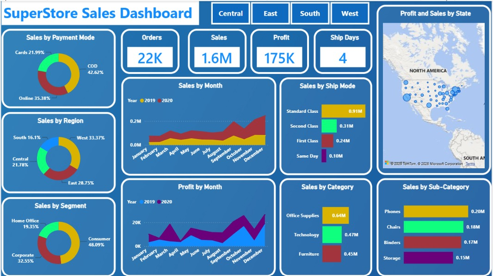

# 📊 SuperStore Sales Dashboard

An interactive **Power BI dashboard** designed to analyze SuperStore sales performance and provide actionable business insights through interactive visualizations, KPIs, and filters.



---

## 📌 Project Overview

The **SuperStore Sales Dashboard** is a Business Intelligence project developed using **Microsoft Power BI**.

The objective of this project is to transform raw SuperStore sales data into an interactive dashboard that helps users understand:

- Overall sales and profit performance
- Sales trends over time
- Regional performance
- Product category performance
- Customer segment performance
- Shipping and order trends
- Key business performance indicators

The dashboard allows users to interact with the data using filters and slicers, making it easier to identify trends, compare performance, and support data-driven decisions.

---

## 🎯 Project Objectives

The main objectives of this project are:

1. Analyze overall sales and profit performance.
2. Identify high-performing and under-performing regions.
3. Analyze product categories and sub-categories.
4. Understand sales trends over time.
5. Compare customer segments.
6. Monitor important business KPIs.
7. Build an interactive and user-friendly Power BI dashboard.
8. Convert raw sales data into meaningful business insights.

---

## 🛠️ Tools & Technologies

| Tool | Purpose |
|---|---|
| **Microsoft Power BI** | Dashboard development and data visualization |
| **Power Query** | Data cleaning and transformation |
| **DAX** | Measures and KPI calculations |
| **Microsoft Excel** | Source dataset |
| **GitHub** | Project version control and documentation |

---

## 📂 Repository Structure

```text
SuperStore_sales_dashboard/
│
├── SuperStore Sales DataSet.xlsx
├── SuperStore_sales_dashboard.pbix
├── SuperStore_sales_dashboard.jpeg
└── README.md
```

### 📄 File Description

| File | Description |
|---|---|
| `SuperStore Sales DataSet.xlsx` | Raw SuperStore sales dataset used for analysis |
| `SuperStore_sales_dashboard.pbix` | Complete Power BI dashboard project |
| `SuperStore_sales_dashboard.jpeg` | Dashboard preview image |
| `README.md` | Project documentation |

---

## 📊 Dashboard Features

### 🔹 KPI Analysis

The dashboard provides key performance indicators such as:

- **Total Sales**
- **Total Profit**
- **Total Orders**
- **Total Quantity**
- **Average Sales**
- **Profit Margin**

These KPIs provide a quick overview of the overall business performance.

---

### 🔹 Sales Trend Analysis

Analyze how sales change over time using interactive time-based visualizations.

The analysis can help identify:

- Monthly sales patterns
- Seasonal trends
- Growth and decline periods
- High-performing time periods

---

### 🔹 Regional Analysis

The dashboard provides a comparison of sales and profitability across different regions.

This helps identify:

- Best-performing regions
- Low-performing regions
- Regional sales contribution
- Regional profitability

---

### 🔹 Category & Sub-Category Analysis

Product performance can be analyzed at both category and sub-category levels.

This allows users to identify:

- Top-selling categories
- Most profitable sub-categories
- Low-performing products
- Product-level sales patterns

---

### 🔹 Customer Segment Analysis

The dashboard provides insights into different customer segments and their contribution to sales and profit.

This helps understand:

- Which segments generate the most revenue
- Segment-wise profitability
- Customer purchasing patterns

---

### 🔹 Interactive Filters

Users can dynamically filter the dashboard using available slicers and filters.

Examples include:

- Region
- Category
- Sub-Category
- Segment
- Date
- Product

This makes the dashboard interactive and suitable for business analysis.

---

## 🔄 Data Preparation

The dataset was processed using **Power Query** before creating the dashboard.

The general workflow was:

```text
Raw Excel Dataset
        ↓
Power Query
        ↓
Data Cleaning & Transformation
        ↓
Data Model
        ↓
DAX Measures
        ↓
Power BI Visualizations
        ↓
Interactive Dashboard
```

---

## 🧮 DAX & Data Modeling

DAX measures were used to calculate important business metrics and support interactive analysis.

Examples of metrics include:

```DAX
Total Sales = SUM(Sales[Sales])

Total Profit = SUM(Sales[Profit])

Total Quantity = SUM(Sales[Quantity])

Total Orders = DISTINCTCOUNT(Sales[Order ID])
```

> Note: The exact DAX expressions may vary depending on the column names and data model used in the `.pbix` file.

---

## 💡 Business Insights

The dashboard can be used to answer important business questions such as:

- Which region generates the highest sales?
- Which category contributes the most revenue?
- Which products generate the highest profit?
- Which sub-categories need improvement?
- How are sales changing over time?
- Which customer segment contributes the most sales?
- Which areas have high sales but relatively low profitability?

These insights can support better decisions related to sales strategy, product management, regional planning, and customer targeting.

---

## 🚀 How to Use

### 1. Clone the Repository

```bash
git clone https://github.com/Sakshi-Singh-17/SuperStore_sales_dashboard.git
```

### 2. Open the Project

Open:

```text
SuperStore_sales_dashboard.pbix
```

using **Microsoft Power BI Desktop**.

### 3. Refresh the Data

If required, update the dataset connection and click:

**Home → Refresh**

### 4. Explore the Dashboard

Use the available:

- Slicers
- Filters
- Charts
- KPI cards
- Tables
- Interactive visualizations

to explore the SuperStore sales data.

---

## 📸 Dashboard Preview


---

## 📈 Skills Demonstrated

This project demonstrates practical skills in:

- 📊 Data Visualization
- 📈 Business Intelligence
- 🧹 Data Cleaning
- 🔄 Data Transformation
- 🧮 DAX
- 🔍 Exploratory Data Analysis
- 📐 Data Modeling
- 📊 Dashboard Design
- 💼 Business Analytics
- 🖥️ Power BI

---

## 🎓 Project Type

**Data Analytics / Business Intelligence / Power BI Portfolio Project**

This project demonstrates how raw retail sales data can be transformed into an interactive business intelligence dashboard for analysis and decision-making.

---

## 👩‍💻 Author

**Sakshi Singh**

GitHub:  
https://github.com/Sakshi-Singh-17

---

## ⭐ If You Find This Project Useful

If this project helps you understand Power BI, dashboard development, or business analytics, consider giving the repository a ⭐.

---

## 📜 License

This project is intended for educational and portfolio purposes.
